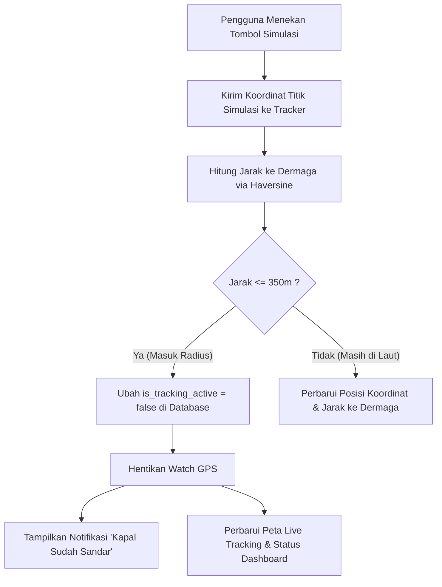

# Rencana Pengembangan: Tombol Simulasi Geofencing Dermaga TPI

Dokumen ini memuat arsitektur dan rencana teknis pengembangan tombol simulasi rute kapal pengangkut untuk mendemonstrasikan fitur **Geofencing Otomatis (Auto-Docking)** pada platform **Parengge Kita**.

---

## 1. Latar Belakang & Tujuan

* **Tantangan Lapangan:** Fitur Geofencing mengandalkan GPS fisik kapal saat mendekati dermaga TPI Galesong Utara. Saat sesi demo, pitching lomba (BMC), maupun pengujian di dalam ruangan (*indoor*), perangkat tidak berada di perairan Galesong.
* **Tujuan Fitur:** Menyediakan kontrol simulasi yang memungkinkan pengguna/penguji menyimulasikan pergerakan kapal mendekati dermaga hingga memicu *auto-docking* secara realistis dan interaktif.

---

## 2. Parameter Geofencing Dermaga

| Parameter | Nilai / Spesifikasi | Keterangan |
| :--- | :--- | :--- |
| **Pusat Dermaga TPI** | `-5.3216, 119.3625` | Titik koordinat pendaratan kapal TPI Galesong Utara |
| **Radius Geofence** | `350 meter` | Batas toleransi kapal dianggap telah bersandar |
| **Algoritma Jarak** | *Haversine Formula* | Menghitung jarak geodesik antar titik koordinat secara presisi dan efisien |
| **Dampak Status** | `is_tracking_active = false` | Menghentikan pelacakan GPS dan mencatat status sandar |

---

## 3. Desain Kontrol Simulasi

### Opsi A: Tombol Dedicated Cepat (*Recommended*)
Menambahkan dua tombol simulasi berdampingan pada panel kontrol pengangkut:
1. **Simulasi Titik Laut:** Mengirim koordinat acak kapal saat masih berlayar di perairan lepas.
2. **Simulasi Tiba di Dermaga:** Langsung mengirim koordinat dermaga TPI Galesong (`-5.3214, 119.3623`), memicu algoritma Geofencing secara instan.

### Opsi B: Kontrol Skenario Bertahap (Stepper Scenario)
Dropdown pemilih tahapan perjalanan kapal:
* **Tahap 1:** Laut Lepas Area Puma/Kalmas (~7.5 km dari TPI)
* **Tahap 2:** Memasuki Jalur Pelayaran Pesisir (~1.4 km dari TPI)
* **Tahap 3:** Manuver Sandar Dermaga TPI (< 50 meter dari dermaga $\rightarrow$ *Geofence Trigger*)

---

## 4. Alur Kerja Sistem (Workflow)

---

## 5. Rincian Teknis Implementasi

1. **Komponen yang Dimodifikasi:**
   * [`GeolocationTracker.tsx`](file:///d:/Lomba/BMC%20Ainull/src/components/GeolocationTracker.tsx): Menangani event klik simulasi, kalkulasi jarak, dan pembaruan state.
   * [`utils.ts`](file:///d:/Lomba/BMC%20Ainull/src/lib/utils.ts): Menyediakan konstanta koordinat dermaga dan fungsi kalkulator Haversine.

2. **Dampak Tampilan (UI/UX):**
   * Desain tombol minimalis dan modern menggunakan Lucide icons (`Radio` dan `Anchor`).
   * Menampilkan badge jarak real-time: *"Jarak ke Dermaga: X km / X m"*.
   * Mempertahankan tombol manual *"Sudah Sandar di TPI"* sebagai fallback.

---

## 6. Jadwal & Checklist Pelaksanaan

- [x] Implementasi algoritma Haversine & konstanta dermaga TPI di `src/lib/utils.ts`
- [x] Integrasi deteksi radius geofence otomatis pada `GeolocationTracker.tsx`
- [x] Simulasi bertahap pada tombol *"Simulasi Titik Laut"*
- [ ] Opsi penambahan dedicated button *"Simulasi Sandar TPI"* jika disepakati
- [ ] Verifikasi sinkronisasi realtime pada Peta Live Tracking dan Dashboard Admin
