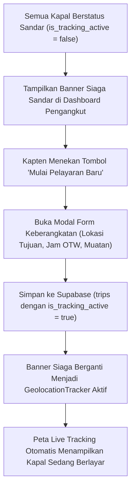

# Rencana Pengembangan: 02 - Mulai Pelayaran Baru (Banner Siaga & Re-Aktivasi GPS)

Dokumen ini memuat rencana teknis dan arsitektur pengembangan fitur **Banner Siaga Sandar & Mulai Pelayaran Baru** pada Dashboard Kapal Pengangkut di platform **Parengge Kita**.

---

## 1. Latar Belakang & Masalah

* **Kondisi Saat Ini:** Ketika seluruh pelayaran kapal pengangkut telah selesai bersandar di TPI Galesong (`is_tracking_active = false`), banner pelacakan GPS di dashboard pengangkut langsung menghilang tanpa meninggalkan status informasi.
* **Permasalahan Pengguna:** Kapten kapal tidak memiliki penanda visual bahwa kapal sedang bersandar di dermaga, serta belum ada alur cepat yang memandu kapten saat kapal hendak bertolak berlayar kembali ke laut (Area Puma atau Kalmas).

---

## 2. Tujuan & Sasaran Fitur

1. **Memberikan Status Visual yang Jelas:** Menampilkan banner status siaga (*standby state*) ketika kapal sedang bersandar di dermaga TPI Galesong Utara.
2. **Alur Keberangkatan Cepat:** Menyediakan tombol aksi utama *"Mulai Pelayaran Baru / Berangkat Lagi"* tepat pada banner siaga.
3. **Re-Aktivasi Pelacakan GPS:** Membuka formulir keberangkatan baru, mengaktifkan kembali `is_tracking_active = true`, dan menyalakan siaran GPS real-time ke Landing Page dan Dashboard Admin.

---

## 3. Desain Antarmuka (UI/UX)

### Banner Siaga Sandar (*Standby Docking Banner*)
Ditempatkan di posisi banner tracker pada [`src/app/dashboard/pengangkut/page.tsx`](file:///d:/Lomba/BMC%20Ainull/src/app/dashboard/pengangkut/page.tsx):

* **Latar Belakang:** Latar navy bersih khas platform (`bg-[#0A2E4D]`) dengan aksen border subtle (`border-slate-700`).
* **Ikon:** `Anchor` (Jangkar) atau `Ship` berwarna biru langit (`text-sky-400`).
* **Teks Status:**
  * **Judul:** *Armada Sedang Bersandar di Dermaga TPI Galesong Utara*
  * **Deskripsi:** *Pelacakan GPS nonaktif. Klik tombol di sebelah kanan saat kapal hendak bertolak berlayar kembali ke laut.*
* **Tombol Aksi:**
  * Tombol utama berlatar hijau/biru laut: `[ 🚀 Mulai Pelayaran Baru ]`
  * Opsi sekunder: Re-aktivasi trip terakhir jika kapten tidak sengaja menekan tombol sandar.

---

## 4. Alur Kerja Sistem (Workflow)

---

## 5. Rincian Teknis Implementasi

1. **Dashboard Pengangkut ([`src/app/dashboard/pengangkut/page.tsx`](file:///d:/Lomba/BMC%20Ainull/src/app/dashboard/pengangkut/page.tsx)):**
   * Pengecekan kondisi:
     * Jika `activeTripToday` ada $\rightarrow$ Tampilkan komponen `GeolocationTracker`.
     * Jika `activeTripToday` tidak ada $\rightarrow$ Tampilkan komponen **Banner Siaga Sandar**.
   * Menghubungkan tombol pada banner siaga langsung ke pemicu modal formulir muatan baru (`setIsModalOpen(true)`).

2. **Komponen Pembantu:**
   * Menambahkan tombol opsi re-aktivasi cepat pada kartu muatan terakhir (`ManifestCard`) jika terjadi salah klik sandar.

3. **Sinkronisasi Database:**
   * Mengirim payload `is_tracking_active: true` beserta reset koordinat pangkalan ke tabel `trips` di Supabase.

---

## 6. Jadwal & Checklist Pelaksanaan

- [ ] Pembuatan komponen Banner Siaga Sandar di Dashboard Pengangkut
- [ ] Pengikatan event klik ke modal pembukaan pelayaran baru
- [ ] Penambahan opsi tombol re-aktivasi cepat pada trip yang baru saja bersandar
- [ ] Pengujian siklus penuh: *Berlayar $\rightarrow$ Geofence Sandar $\rightarrow$ Siaga $\rightarrow$ Berlayar Kembali*
